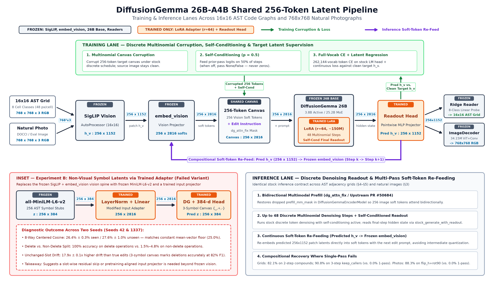

# Latent Roadmaps: DiffusionGemma State Transitions for Code-Graph Refactoring

**Author:** [`bumblebeers`](https://github.com/bumblebeers)



This repository contains the benchmark specification, pre-registration (`PREREG.json`), training/evaluation runners, offline scoring suite, and analysis artifacts for studying **multi-step AST call-graph state transitions** on DiffusionGemma's (`google/diffusiongemma-26B-A4B-it`) 256-token bidirectional canvas alongside matched `google/gemma-4-26B-A4B-it` autoregressive and scratch transformer baselines.

---

## Live Ecosystem & Standalone Packages

| Resource | Platform | Link |
| :--- | :--- | :--- |
| **`dgg2-latent-code-graphs`** (Main Benchmark, Runners & Paper) | GitHub | [bumblebeers/dgg2-latent-code-graphs](https://github.com/bumblebeers/dgg2-latent-code-graphs) |
| **`dgg-latent`** (Continuous Latent Diffusion, Losses & Readout Heads) | GitHub (`v0.1.0`) | [bumblebeers/dgg-latent](https://github.com/bumblebeers/dgg-latent) |
| **`dgg-codebook`** (Continuous Vocabulary Chords, De-Biasing & Spatial Teachers) | GitHub (`v0.1.0`) | [bumblebeers/dgg-codebook](https://github.com/bumblebeers/dgg-codebook) |
| **`dgg-vit-decoder`** (Loader for 572.8M SigLIP Vision Stack & 34.15M ViT+Conv Decoder) | GitHub (`v0.1.0`) | [bumblebeers/dgg-vit-decoder](https://github.com/bumblebeers/dgg-vit-decoder) |
| **Multimodal Prefill Mask Fix (`DiffusionGemmaEncoderModel`)** | GitHub PR & Fork | [huggingface/transformers#50684](https://github.com/huggingface/transformers/pull/50684) · [bumblebeers/transformers (`fix/diffusion-gemma-prefill-multimodal-masks`)](https://github.com/bumblebeers/transformers/tree/fix/diffusion-gemma-prefill-multimodal-masks) |
| **AST Code-Graph Benchmark Packs & Raw `.npy`/`.npz` Predictions** | Hugging Face Datasets | [bumblebeer/dgg2-code-graph-benchmarks](https://huggingface.co/datasets/bumblebeer/dgg2-code-graph-benchmarks) |
| **AST Code-Graph Benchmark Packs (Mirror)** | Kaggle Datasets | [unclebumblebeer/dgg2-code-graph-benchmarks](https://www.kaggle.com/datasets/unclebumblebeer/dgg2-code-graph-benchmarks) |
| **Trained Two-Seed LoRA Adapters, Readout Heads & `ImageDecoder` Weights** | Hugging Face Models | [bumblebeer/dgg2-latent-code-graphs-adapters](https://huggingface.co/bumblebeer/dgg2-latent-code-graphs-adapters) |

---

## Repository Structure

- **`cg/`** — Deterministic AST extraction, 16×16 palette call-graph rendering, pre-registration verifier, and offline GPU-free scoring harness:
  - `cg/cg_extract.py`: Python `ast` symbol + call-edge extractor across real Python repositories (3 training repos: `fastapi`, `requests`, `rich`; 2 zero-shot evaluation repos: `httpx`, `click`).
  - `cg/cg_ops.py` & `cg/cg_instructions.py`: 22 fixed candidate states, 3 open-ended operations, held-out node/edge transformations, and paraphrase/indirect-intent banks.
  - `cg/cg_sec27_spec.py`: Contrastive training schedule (`4,824` optimizer steps, two seeds: `42`, `1337`) and held-out evaluation manifests.
  - `cg/cg_hv_probe.py`: Gate A1 closed-form Ridge probe mapping `h_v` (`256×1152`) to 8 discrete palette classes (`1.000` clean accuracy at 16×16).
  - `cg/cg_score_preds.py`: Offline Experiment A scorer reporting 22-way nearest-candidate match, 256-cell exact-grid match, changed/unchanged cell accuracy, and call-edge F1.
  - `cg/cg_node_dataset.py` & `cg/cg_node_metrics.py`: Experiment B 256-symbol continuous `all-MiniLM-L6-v2` window builder and 8-way centered-cosine evaluator.
  - `cg/cg_prereg.py`: Cryptographic SHA-256 verification against `PREREG.json`.
- **`src/`** — Model runners (`cg_colab_runner.py`, `cg_gemma4_ar_runner.py`, `cg_nondg_model.py`, `dg_attn_fix.py`), standalone libraries (`src/dgg_latent`, `src/dgg_codebook`, `src/dgg_vit_decoder`), figure generators, and release staging scripts.
- **`docs/`** — Writeup manuscript (`docs/paper_draft.md`), verified metrics ledger (`docs/PAPER_DATA_SUMMARY.md`), upstream mask-fix technical note (`docs/UPSTREAM_PR_MASK_FIX.md`), and figures (`docs/figures/`).
- **`notebooks/`** — Reproducible review & offline rescoring notebook (`notebooks/dgg2_latent_code_graphs_demo.ipynb`, generated deterministically via `src/build_review_notebook.py`).
- **`tests/`** — Unit and 4-tier end-to-end verification suite (`125+` tests across `tests/unit/` and `tests/e2e/`).

---

## Quickstart & Independent Verification

All benchmark packs (`data/gridA_*.npz`, `data/nodeB_*.json.gz`, `data/graphs/*.json.gz`), probe weights (`reader.npz`), summary JSON reports (`outputs/`), and decoded grid predictions (`outputs/m2/decoded_grids_all_arms.npz`) are included directly in this repository so verification runs **out-of-the-box on a fresh offline clone**:

```bash
# 1. Install core dependencies and standalone packages
pip install -e .
pip install -e src/dgg_latent -e src/dgg_codebook -e src/dgg_vit_decoder

# 2. Verify immutable pre-registration hashes (PREREG.json)
python3 cg/cg_prereg.py --check

# 3. Run offline Experiment A self-test & unit/e2e test suite (CPU-only, no 26B GPU needed)
python3 cg/cg_score_preds.py --self-test
pytest -q tests/unit tests/e2e

# 4. (Optional) Pull raw .npy prediction arrays & MiniLM symbol embeddings from Hugging Face into repo root (.):
python3 -c "from huggingface_hub import snapshot_download; snapshot_download('bumblebeer/dgg2-code-graph-benchmarks', repo_type='dataset', local_dir='.', allow_patterns=['emb*.npz', 'predictions/*'])"
```

## License

Apache License 2.0 (`LICENSE`).
