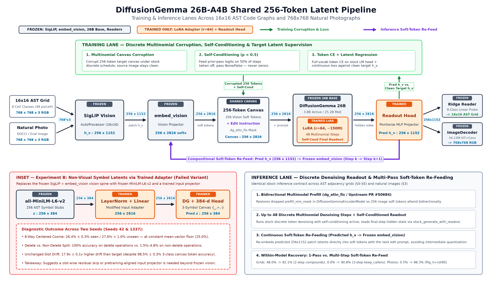

# Title: Latent Roadmaps: Soft-Token Re-Feeding in DiffusionGemma for Code Graphs

### Subtitle: We adapt DiffusionGemma to chain code-graph edits by re-feeding its own predicted vision latents, recovering edits that fail in one pass.

**Author:** `bumblebeers`

---

## 0. Abstract

Autoregressive code models emit syntax left-to-right before downstream call-graph effects resolve. We study **Latent Roadmaps**: executing caller-specified AST call-graph edits on DiffusionGemma's (DG 26B-A4B) bidirectional 256-token canvas without code synthesis. To our knowledge, this is the first adaptation of a pretrained text-diffusion LLM to execute chained latent state transitions by re-feeding its own predicted vision latents; unlike the model's built-in self-conditioning between denoising steps, re-feeding operates across complete generations. Within two-seed LoRA DG weights on `httpx` (N=360), caller-supplied re-feeding lifts 5-compound accuracy from **48.0±1.7%** (1-pass) to **82.1±1.0%** 22-way (**47.8±2.2%** exact; `reverse_edges + keep_callees`: **0.3%→100.0%**), 3-step `keep_callers` from **0.0%** to **90.8±4.2%** (**0.0%** exact; `mark_ancestors`: **0.0%**), natural-image `flip_h` then `rot90` (N=300 DOCCI) from **0.5%** to **88.3±1.7%**, and zero-shot `click` 2-step re-feeding to **83.5±1.8%** (**90.7%** seen); steps are caller-supplied, and re-feeding also aids non-diffusion (34.6%) and autoregressive (55.0%) baselines. On 1-pass `httpx`, LoRA DG beats ~50M Non-DG transformers (**91.9%** vs. **75.7%** seen 22-way; **62.2%** vs. **7.2%** exact, tied with copy; **78.5%** paraphrases; **61.4%** indirect intent) and commits deterministically on ambiguous edits (single-sample **50.4%** unseen vs. **15.1%** Non-DG). As a preliminary reference, 2-shot **Gemma 4 26B-A4B-it** AR scores **15.6%** seen, while **Gemma 4 AR LoRA**—stopped at 354 of 4,824 steps (7% of DG's schedule)—scores **73.9%** seen (13.6% exact), **70.6%** paraphrases, **55.0%** 2-step re-feed, and **72.2%** indirect intent. Two-seed Experiment B (**26.4%** seen) suggests reconstructing 384-d symbol vectors without a residual skip incurs 17.9× drift.

---

## 1. Introduction & Scope

Autoregressive code models emit tokens left-to-right under causal masking before transitive call-graph dependencies resolve, whereas engineers reason over dependency graphs before editing code.

We test whether a pretrained discrete text-diffusion LLM executes **chained structural state transitions** on its 256-token canvas. To our knowledge, this is the first adaptation of a pretrained text-diffusion LLM to execute chained latent state transitions by re-feeding its own predicted vision latents; unlike the model's built-in self-conditioning between denoising steps, re-feeding operates across complete generations. At generation `k`, a readout head maps final-step hidden states (`256×2816`) to predicted SigLIP latents `h_v_hat` (`256×1152`). Re-feeding passes `h_v_hat` directly into frozen `embed_vision` with instruction `k+1` to form the next 256-token canvas, avoiding RGB or grid quantization. **Scope is explicit: our system executes caller-supplied decompositions rather than planning chains autonomously, and evaluates latent graph states rather than synthesizing Python code.**

*Figure 1: Caller-decomposed re-feeding on held-out `keep_callers` (`idx 72`, seed 42; Panel 2 shows ground-truth Step 1). Single-pass inference lands on `keep_callees`, whereas 3-step `embed_vision` re-feeding (`reverse_edges → keep_callees → reverse_edges`) recovers 22-way match (90.8±4.2% split-wide) while red outlines show cell drift (0.0% exact).*

---

## 2. Background & Representation Architecture

### 2.1 DiffusionGemma Stock Contract & Dual Representations
DG 26B-A4B (3.8B active / 25.2B MoE) denoises a 256-token canvas across up to 48 multinomial steps with self-conditioning (`p=0.5`), bidirectional multimodal prefill (`dg_attn_fix`), and final self-conditioned readout (`stock_generate_with_readout`).
- **Experiment A (Visual Adjacency Grids):** 16-symbol AST call graphs render as 16×16 8-color grids at 768² RGB (48 px/cell), yielding `h_v` (`256×1152`) via frozen SigLIP and `embed_vision`. Pointwise readouts predict `h_v_hat`, decoded into 8 classes (`background`, `edge`, `func`, `method`, `class`, `test`, `selected`, `marked`) by a clean-`h_v` Ridge reader.
- **Experiment B (Continuous Symbol Latents):** 256-symbol AST stubs embedded via frozen `all-MiniLM-L6-v2` (`d=384`) enter DG via `LayerNorm(384) + Linear(384, 2816)` (**modified model: trained input adapter**, our sole non-stock input interface), paired with a 3-symbol canvas (`_` unchanged, `+` edited, `-` deleted) and 384-d readout.

*Figure 2: Shared frozen SigLIP + `embed_vision` spine, trained LoRA (`r=64`) and readout head, cross-generation re-feed loop, and Experiment B's failed adapter inset.*

### 2.2 Anisotropy Alignment
Because raw `h_v` and pooled states occupy narrow cones (`cos ≈ 0.30–0.99`, `PR ≈ 2.4`), we center by the training mean (`cent_cos`) and Z-standardize channels before lookups.

|Dimension|Natural Images|Exp A: Adjacency Grids|Exp B: Symbol Latents|
|:---|:---|:---|:---|
|Layout|DOCCI 768² (16×16 patches)|16-node AST (16×16 cells)|256-symbol AST window|
|Encoder|Frozen SigLIP|Frozen SigLIP|Frozen `all-MiniLM-L6-v2`|
|Latents|256×1152 (`h_v`) → 2816|256×1152 (`h_v`) → 2816|256×384 (`z`) → 2816|
|Input Path|Frozen `embed_vision`|Frozen `embed_vision`|Trained `LayerNorm+Linear`|
|Evaluation|24-way `h_v` cosine & PSNR|22-way & Exact-grid match|8-way centered cosine|

*Table 1: Cross-domain representation and evaluation summary.*

---

## 3. Empirical Foundation: Natural-Image Patch Transitions

On N=300 held-out DOCCI photos (24 states, `chance = 4.2%`), two-seed LoRA DG (`r=64`, ~150M params) beats 53.6M Non-DG controls on identity (17.28 dB PSNR, 100.0% R@1 vs. Frozen DG 12.41 dB, 7.3%), 6-way geometry (100.0% seen, 89.5% unseen vs. 55.8%), mixed edits, and held-out `blue_tint`:

|Manifest (N=300, K=24)|Dec Ceil|Copy|Frozen DG|Non-DG Frz|Non-DG EncLoRA|**LoRA DG (2-Seed)**|McNemar|
|:---|:---:|:---:|:---:|:---:|:---:|:---:|:---:|
|`seen_bal300`|100.0%|4.7%|12.7%|74.5±1.5%|74.8±0.5%|**91.3±0.0%**|p<1e-11|
|`seen_shuf300` (Shuffled)|100.0%|4.7%|3.0%|2.2±0.5%|1.8±0.2%|**0.0±0.0%**|—|
|`unseen_para_bal300`|100.0%|4.7%|12.3%|32.7±0.3%|61.3±0.3%|**90.5±0.5%**|p<1e-20|
|`heldout_blue_tint_300`|100.0%|0.0%|3.7%|0.0±0.0%|0.0±0.0%|**60.2±5.8%**|p<1e-59|
|`heldout_flip_h_then_rot90`|100.0%|0.0%|2.3%|0.3±0.3%|0.0±0.0%|**0.5±0.2%**|—|
|`refeed_geogeo_bal300` (2-Step)|100.0%|0.0%|3.7%|67.7±1.3%|65.2±0.8%|**88.3±1.7%**|p<1e-17|

*Table 2: Natural-image 24-way accuracy (N=300 DOCCI).*

Intact vs. internally rotated patches tie (0.3291 vs. 0.3297, p=0.68), motivating 1-cell-per-patch 16×16 grids; 1-pass `flip_h_then_rot90` fails (**0.5±0.2%**, `brighten`→`darken`: 8.2%), whereas `embed_vision` re-feeding recovers **88.3±1.7%** (geo×photo: **92.0±0.3%**).

---

## 4. Methods: Code Graphs, Baselines & Metrics

### 4.1 Pre-Registered Empirical Gates (`PREREG.json`)

|Gate|Domain|Metric|Rule|Outcome|Status|
|:---|:---|:---|:---|:---|:---:|
|**Gate A1 (16²)**|Exp A (16²)|Clean-`h_v` Ridge cell acc|≥0.99 cell, ≥0.95/class|**1.000 all 8 classes**|**PASS**|
|**Gate A1 (32/48²)**|Exp A (32/48²)|Sub-patch packing probe|≥0.99 cell, ≥0.95/class|Cell >0.99, `selected` **0.132**|**FAIL**|
|**Gate A2**|Exp A (Pool)|Max off-target centered cos|Report fraction >0.85|Median 0.8757 (**72.8% >0.85**)|**Measured**|
|**Gate A3**|Exp A (Control)|Non-DG EncLoRA `seen_bal360`|Changed-cell acc >0.0|**90.0% changed** (73.3% 22-way)|**PASS**|
|**Gate B0**|Exp B (Encoder)|`all-MiniLM-L6-v2` isotropy|PR ≥ 20, cos ≤ 0.20|**PR=47.8, cos=-0.0015, Oracle=1.0**|**PASS**|
|**Gate B1**|Exp B (Control)|Non-DG delete slot hit|≥50% (chance 0.39%)|**52.2% (47/90)**|**PASS**|

*Table 3: Pre-registered gate verification prior to DG training.*

Gate A1 confirms lossless 16×16 decoding while 32²/48² packing crushes `selected` (13.2%); 8-color separation also avoids SigLIP LayerNorm luminance loss (48.2%/23.2% vs. 83.3±2.7% on palette conditionals, p<1e-12).

### 4.2 Metrics & Baseline Definitions
- **Exp A & B Metrics:** On Ridge-decoded 16×16 grids, we report **22-way accuracy** (unique nearest Hamming candidate; ties wrong; chance 4.5%), **256-cell exact match**, and call **edge F1**. Exp B uses 8-way centered-cosine lookup at edited slots (`chance=12.5%`, `mean floor=25.0%`).
- **Baselines (`Non-DG` & `Gemma 4` AR Reference):** `NonDGTransformBaseline` is a scratch 4-layer (`d=768`, 12-head) cross-attention transformer (`51.7M` Exp A, `49.9M` Exp B, `53.6M` images) with slot residuals (`x ← x+SA+CA+FFN`) and `all-MiniLM-L6-v2` (**Frozen Instr** or `r=16` **Enc LoRA**). **`google/gemma-4-26B-A4B-it`** shares the 26B-A4B trunk and frozen 256-token SigLIP vision stack **but not the training budget**, emitting 256 raster digits (`0`–`7`): **Gemma 4 AR Prompted** (image + source digits + 2 exemplars, 2-shot) and **Gemma 4 AR LoRA** (`r=64`, `74.3M` LM params, single seed `42`, stopped at **354 of 4,824 steps** at cutoff).
- **Training:** Full runs train 4,824 steps (seeds `42`, `1337`) on 1,608 subgraphs from 3 repos (`fastapi`, `requests`, `rich`), tested zero-shot on `httpx` and `click` (N=360 each); unfinished runs are `not run`.

---

## 5. Experimental Results & Analysis

|Model Arm|Natural Images (K=24)|Exp A: Code Graphs (K=22)|Exp B: Symbol Latents (K=8)|Architecture|
|:---|:---:|:---:|:---:|:---|
|**Oracle Ceiling**|100.0% (23.3dB)|100.0% (100% Exact)|100.0% (1.000 Cos)|Ground-truth latent|
|**Chance / Mean Floor**|4.2% chance|4.5% chance|12.5% ch. / 25.0% mean|Analytical floor|
|**Source Copy**|4.7%|7.2% (7.2% Exact)|0.0% hit (0.0 drift)|Unmodified input|
|**Non-DG + Frozen Instr**|74.5% / 32.7%|75.7±4.6% / 39.6±0.4%|46.1±3.9% / 41.7±2.8%|Scratch ~50M + Frz Text|
|**Non-DG + Enc LoRA**|74.8% / 61.3%|73.3±0.0% / 49.2±3.6%|**47.4±1.3%** / **41.3±4.3%**|Scratch ~50M + Enc LoRA|
|**Gemma 4 AR (Prompted, 2-Shot)**|not run|15.6% / 13.3%|not run|26B-A4B AR (2-Shot)|
|**Gemma 4 AR (LoRA r=64, 354 of 4,824 steps, single seed)**|not run|73.9% / 70.6%|not run|26B-A4B AR + LoRA (7% budget)|
|**Frozen DG + Head**|12.7% / 12.3%|0.3% / 0.0%|not run|Frozen 26B + Readout|
|**LoRA DG**|**91.3%** / **90.5%**|**91.9±1.1%** / **78.5±3.2%**|26.4±0.3% / 27.6±1.0%|26B + LoRA (r=64) + Head|

*Table 4: Seen / unseen paraphrase K-way accuracy (`httpx` N=360; DOCCI N=300).*

|Manifest (`httpx`, N=360)|LoRA DG: 22-Way (Exact, F1)|Best Non-DG: 22-Way (Exact)|Gemma 4 AR Prompted: 22-Way (Exact, Parse)|Gemma 4 AR LoRA: 22-Way (Exact, Parse)|Copy Exact|
|:---|:---:|:---:|:---:|:---:|:---:|
|`seen_bal360`|**91.9±1.1%** (**62.2±4.2%**, 94.6%)|75.7±4.6% (**7.2%**)|15.6% (**7.5%**, 99.4% parse)|73.9% (**13.6%**, 89.4% parse)|7.2%|
|`unseen_para_bal360`|**78.5±3.2%** (**47.1±3.7%**, 84.1%)|49.2±3.6% (**3.3%**)|13.3% (**6.4%**, 99.4% parse)|70.6% (**14.7%**, 83.9% parse)|7.2%|
|`unseen_infer_360`|**61.4±2.5%** (**41.2±1.2%**, 79.7%)|23.2±1.2% (**0.0%**)|17.5% (**8.9%**, 99.4% parse)|**72.2%** (13.6%, 85.3% parse)|11.1%|
|`refeed_heldout_comp` (2-Step)|**82.1±1.0%** (**47.8±2.2%**, 98.0%)|34.6±2.4% (**0.0%**)|0.6% (**0.0%**, 99.4% parse)|55.0% (**6.4%**, 86.9% parse)|0.0%|
|3-Step `keep_callers` (n=180)|**90.8±4.2%** (**0.0±0.0%**, 73.1%)|0.0±0.0% (0.0%)|not run|not run|0.0%|

*Table 5: 22-way accuracy, 256-cell exact match, call-edge F1, and AR exact-256 parse rate on `httpx` (Gemma 4 AR LoRA: 354 of 4,824 steps, single seed; visual summary in `figures/fig5_accuracy_dotplot.png`).*

### 5.1 Caller-Decomposed Soft-Token Re-Feeding & 3-Step Mirror Chains
Within identical LoRA DG weights, re-feeding predicted `h_v_hat` (`256×1152`) through frozen `embed_vision` recovers multi-step edits that fail in one pass:
- **2-Step Compounds (`httpx` & `click`):** Across 5 compounds (`refeed_heldout_comp`), re-feeding lifts LoRA DG from **48.0±1.7%** (1-pass) to **82.1±1.0% 22-way** and **47.8±2.2% exact** (98.0% F1; vs. Non-DG 34.6%, p<1e-41), lifting `reverse_edges + keep_callees` from **0.3%** to **100.0±0.0%**, `delete_tests + mark_reachable` to **70.1±2.1%**, and `reverse_edges + mark_reachable` to **40.3±2.8%**. Zero-shot two-seed `click` 2-step re-feeding reaches **83.5±1.8%** (**47.2±6.4% exact**, 98.4% F1 vs. Non-DG 41.0% / 0.0% exact), alongside natural-image `flip_h_then_rot90` (**0.5%→88.3±1.7%**).
- **3-Step Mirror Chain (`keep_callers`, Figure 1):** Chaining `reverse_edges → keep_callees → reverse_edges` lifts unseen `keep_callers` from **0.0%** (1-pass) to **90.8±4.2% 22-way** (`n=180`; 45.4±2.1% chain-wide; Non-DG/Frozen DG: 0.0%, p<1e-51).
- **Required Limits:** Step decomposition is caller-supplied. Re-feeding is not exclusive to DG: it also helps `Gemma 4 AR LoRA` (**55.0%**, 6.4% exact; 80.6% on `reverse_edges + keep_callees`, 1.4% on both `+*mark_reachable` pairs) and scratch `Non-DG` (**34.6±2.4%**, 0.0% exact). Further, **3-step exact match is 0.0% on both seeds** (97.2% cell acc, 73.1% `keep_callers` F1, 84.5% chain F1) from single-cell drift, and `mark_ancestors` is **0.0%**.

### 5.2 Single-Edit Transitions, Budget-Truncated AR Reference & `click` Transfer
- **LoRA DG vs. Scratch Non-DG (`figures/fig1_code_graph_contact_sheet.png`):** LoRA DG beats the best Non-DG arm by **+16.2 pp** seen (**91.9±1.1%** vs. 75.7±4.6%, p<1e-8), **+29.3 pp** on paraphrases (p<1e-15), and **+38.2 pp** on indirect intent (p<1e-31), raising seen exact match from **7.2%** (equal to copy; **0.0% exact on non-identity ops**) to **62.2±4.2%**. Shuffled `seen_shuf360` scores **0.6±0.3%**.
- **Preliminary Gemma 4 AR Reference (354 of 4,824 Steps):** 2-shot `Gemma 4 AR Prompted` (99.4% parse) scores **15.6%, 13.3%, 17.5%, and 0.6%** (`delete_tests`: 55.0%; `reverse_order`: 0.0%). `Gemma 4 AR LoRA` (`r=64`, single seed, 354 of 4,824 steps—7% of DG's schedule) reaches **73.9%, 70.6%, 72.2%, and 55.0%** (81.3%, 75.6%, 79.0%, 78.7% F1). Plainly, **AR LoRA leads LoRA DG on 22-way indirect intent (72.2% vs. 61.4%, +10.8 pp)** despite the shorter schedule (`delete_tests`: 95.0%, `delete_classes`: 77.5% vs. DG 2.5%–15.0%), whereas DG's higher exact match (**41.2%–62.2%** vs. **6.4%–14.7%**) is confounded with AR LoRA stopping at 7% (354/4,824) of DG's step budget. AR LoRA scores **0.0%–7.5%** on `mark_reachable`—including **0/14 on depth-1 `mark_reachable`**, so failure is not limited to multi-hop cases—and **15.4%/11.5%** on `reverse_edges+reverse_order`; the cause is untested.
- **Indirect Intent & Zero-Shot `click`:** On `unseen_infer_360`, DG hits **100.0% (40/40)** on `reverse_order`, `delete_selected`, `keep_callees`, and `selected_first`, but fails without verb overlap on `identity` (0/40), `delete_tests` (1–2/40), and `delete_classes` (2–6/40). Zero-shot two-seed `click` reaches **90.7±2.4% / 61.7±0.3% exact** seen, **77.1±4.6% / 46.9±8.3%** paraphrases, and **62.8±3.9% / 38.3±0.0%** indirect intent (vs. Non-DG 72.1%, 46.1%, 24.4%).

### 5.3 Held-Out Node Categories & Commuting Compounds
Zero-shot category transfer fails (`delete_methods`: 13.2±2.9% 22-way, **0.0% exact** vs. Non-DG 6.9±2.8%; 1-pass `keep_callers`/`mark_ancestors`: 0.0%), whereas 1-pass commuting compounds hit **99.3±0.7%** (`reverse_order + delete_selected`, p<1e-89) and **98.6±1.4%** (`+ delete_tests`) vs. Non-DG 8.1%/6.5%.

### 5.4 Open-Ended Edits: Branch Commitment, Not Diversity
On 2–3-target edits (`cut_one_call`, `delete_one_callee`, `delete_one_test`), Non-DG MSE averages branches (**26.0%** seen Enc LoRA, **15.1%** unseen Frozen Instr; Enc LoRA unseen: 11.4%). Single-sample LoRA DG hits **49.5±7.0%** seen and **50.4±5.2%** unseen (**55.0±5.8%** / **56.1±5.3%** valid in any of 4 samples), yet **4 sampler seeds yield `1.005–1.035` distinct valid grids/item**—deterministic commitment rather than diversity.

### 5.5 Experiment B: Cold-Start Continuous Symbol Injection Boundary
Scratch `NonDGTransformBaseline` (49.9M) scores 47.4±1.3% seen and 41.3±4.3% unseen (`click`: 39.2%/32.8%; re-fed k=2: 5.6%→40.9%, k=4: 1.3%→34.2%). Across two seeds (`42`, `1337`), LoRA DG hits **98.5±0.3%** 3-class canvas accuracy yet scores **26.4±0.3% seen, 27.6±1.0% unseen, 25.0±0.3% shuffled, 25.7±0.1% unseen-arg, and 50.0±0.0% `renameclass`** (**100.0% `delete`** vs. **1.5–4.8% non-delete**; **17.9±0.1× drift**; s42 k=2: 5.3%, k=4: 0.6%, `19.3×` drift; s1337 k=2,4 and Frozen DG `not run`), at the 25.0%/50.0% mean floor. Subject to baseline scale differences, this **suggests** reconstructing 256×384 vectors across a 3-symbol canvas without a slot residual skip lets unchanged-slot drift swamp single-symbol edits.

---

## 6. Related Works

1. **Latent World Models & Re-Feeding:** LPN [10], Tycho [16], and DreamTeam [21] model latent program or agent states; Coconut [13] chains *text-latent* states, COVT [20] and Latent Sketchpad [24] use visual tokens, and DINO-WM [25], LeWorldModel [18], and V-JEPA 2 [3] predict in frozen visual space. Unlike purpose-trained discrete-diffusion world models such as Discrete-WAM [29], we adapt a pretrained text-diffusion LLM via a LoRA and readout head around its frozen vision projector.
2. **Code Graphs & Code LLMs:** Code Property Graphs [23], Allamanis et al. [1], GraphCodeBERT [11], and ProGraML [6] model AST/call graphs for GNNs, whereas StarCoder [26] and DeepSeek-Coder [12] decode files left-to-right.
3. **Diffusion LMs & Self-Conditioning:** LLaDA [19], Scaling-DLM [9], and Transfusion [27] study discrete/hybrid diffusion; DiffusionGemma [7] denoises a 256-token canvas analyzed by Asaria et al. [2] and Engels et al. [8]. DiffusionGemma's stock self-conditioning feeds soft token predictions *between denoising steps within one generation*, whereas our re-feeding operates *across complete generations* in vision-latent space.
4. **Grounding & Anisotropy:** PaLM-E [28], RT-2 [5], and GILL [14] project frozen visual latents into LMs; Gao et al. [30] and Ethayarajh [31] analyze narrow cones mitigated by REPA [22], GAP [17], LatentLens [15], and LeJEPA [4].

---

## 7. Reusable Resources & Verifiable Artifacts

- **Standalone Libraries (`v0.1.0`):** [`dgg-latent`](https://github.com/bumblebeers/dgg-latent) (losses, readout heads, `stock_generate_with_readout`), [`dgg-codebook`](https://github.com/bumblebeers/dgg-codebook) (chords, de-biasing, spatial teachers), and [`dgg-vit-decoder`](https://github.com/bumblebeers/dgg-vit-decoder) (loader for the 572.8M SigLIP vision stack and 34.15M `h_v → 768²` decoder); `dgg-latent` and `dgg-vit-decoder` implement the soft-token re-feed loop.
- **Upstream `transformers` Fix ([`huggingface/transformers#50684`](https://github.com/huggingface/transformers/pull/50684), `dg_attn_fix`):** Restores dropped `create_masks_for_generate(...)` assignment in `DiffusionGemmaEncoderModel.forward` under 2D `attention_mask`, persisting through `transformers` 5.22.2 ([fork branch](https://github.com/bumblebeers/transformers/tree/fix/diffusion-gemma-prefill-multimodal-masks)).
- **Benchmarks, Adapters & Raw Predictions:** SHA-256 cataloged at [`bumblebeers/dgg2-latent-code-graphs`](https://github.com/bumblebeers/dgg2-latent-code-graphs) (`PREREG.json`, `cg/cg_score_preds.py`, `cg/cg_node_metrics.py`), [`bumblebeer/dgg2-code-graph-benchmarks`](https://huggingface.co/datasets/bumblebeer/dgg2-code-graph-benchmarks) and [`unclebumblebeer/dgg2-code-graph-benchmarks`](https://www.kaggle.com/datasets/unclebumblebeer/dgg2-code-graph-benchmarks) (`.npz` packs plus raw `.npy` predictions: `uint8` `(360, 16, 16)` grids in `predictions/expA_grids/` and `outputs/m2/decoded_grids_all_arms.npz`, `(360, 256, 1152)` `h_v` in `predictions/expA_hv/`, and `(N, 256, 384)` Exp B vectors in `predictions/expB_vec/`), and [`bumblebeer/dgg2-latent-code-graphs-adapters`](https://huggingface.co/bumblebeer/dgg2-latent-code-graphs-adapters) (two-seed DG LoRA, single-seed 354-step Gemma 4 AR LoRA, readout heads, and `ImageDecoder`).

---

## 8. Limitations & Future Work

1. **Budget Parity & Raw-Source Baselines:** ~50M `NonDGTransformBaseline` differs in scale from 26B DG, `Gemma 4 AR LoRA` stopped at 354 of 4,824 planned steps (single seed, 7% budget)—leaving open whether DG's exact-match advantage survives an equally trained AR baseline—and we test 16×16 graphs rather than AR agents editing Python source files.
2. **Caller Decomposition & No Synthesis:** Re-feeding requires caller-supplied steps, and predicted graphs are not compiled into source diffs.
3. **Resolution, Drift & Cold-Start Adapters:** 32²/48² packing crushes `selected` (13.2%), 3-step chains get 0.0% exact match (`mark_ancestors`: 0.0%), and Exp B incurs 17.9× drift without a tested gated residual (`z_hat = g * z_dec + (1 - g) * z_src`).

*The natural-image study (§3) was human-designed and human-led with LLM coding assistance. The code-graph experiments (§4–§5) were run in the final 48 hours by an LLM agent under the author's direction, with two seeds; all predictions are released for independent rescoring.*

---

## References

[1] M. Allamanis et al., "Learning to Represent Programs with Graphs," ICLR, 2018.  
[2] C. Asaria et al., "Neither Parallel Nor Sequential: How DiffusionGemma Actually Commits Tokens," arXiv:2606.14620, 2026.  
[3] M. Assran et al., "V-JEPA 2: Self-Supervised Video Models," arXiv:2506.09985, 2025.  
[4] R. Balestriero & Y. LeCun, "LeJEPA: Self-Supervised Learning Without Heuristics," arXiv:2511.08544, 2025.  
[5] A. Brohan et al., "RT-2: Vision-Language-Action Models," arXiv:2307.15818, 2023.  
[6] C. Cummins et al., "ProGraML: Graph-based Program Representation," ICML, 2021.  
[7] DiffusionGemma Team, "DiffusionGemma Technical Report," arXiv:2608.00146, 2026.  
[8] J. Engels et al., "How Transparent is DiffusionGemma?," arXiv:2606.20560, 2026.  
[9] S. Gong et al., "Scaling Diffusion LMs via Adaptation from AR Models," ICLR, 2025.  
[10] M. V. Macfarlane & C. Bonnet, "Searching Latent Program Spaces," NeurIPS, 2025.  
[11] D. Guo et al., "GraphCodeBERT: Pre-training Code Representations with Data Flow," ICLR, 2021.  
[12] D. Guo et al., "DeepSeek-Coder," arXiv:2401.14196, 2024.  
[13] S. Hao et al., "Training LLMs to Reason in a Continuous Latent Space," arXiv:2412.06769, 2024.  
[14] J. Y. Koh et al., "Generating Images with Multimodal LMs," arXiv:2305.17216, 2023.  
[15] B. Krojer et al., "Revealing Highly Interpretable Visual Tokens in LLMs," arXiv:2602.00462, 2026.  
[16] J. Lehmann et al., "Tycho: Programmatic World Models for ARC-AGI-3," arXiv:2607.28287, 2026.  
[17] Y. Miao et al., "Fill the GAP: Granular Alignment for Visual Reasoning," arXiv:2605.12374, 2026.  
[18] Q. Maes et al., "LeWorldModel: End-to-End JEPA," arXiv:2603.19312, 2026.  
[19] S. Nie et al., "Large Language Diffusion Models," ICML, 2025.  
[20] Y. Qin et al., "Chain-of-Visual-Thought: Continuous Visual Tokens," arXiv:2511.19418, 2025.  
[21] E. Sarafian et al., "Workspace Optimization: How to Train Your Agent," arXiv:2605.09650, 2026.  
[22] S. Yu et al., "Representation Alignment for Generation," ICLR, 2025.  
[23] F. Yamaguchi et al., "Vulnerability Discovery with Code Property Graphs," IEEE S&P, 2014.  
[24] H. Zhang et al., "Latent Sketchpad: Sketching Visual Thoughts in MLLMs," arXiv:2510.24514, 2025.  
[25] G. Zhou et al., "DINO-WM: World Models on Pre-trained Visual Features," arXiv:2411.04983, 2024.  
[26] R. Li et al., "StarCoder: may the source be with you!," TMLR, 2023.  
[27] C. Zhou et al., "Transfusion: Next Token and Diffuse Images in One Model," arXiv:2408.11039, 2024.  
[28] D. Driess et al., "PaLM-E: An Embodied Multimodal LM," ICML, 2023.  
[29] Z. Yao et al., "Discrete-WAM: Unified Discrete Vision-Action Token Editing for World-Policy Learning," arXiv:2606.05645, 2026.  
[30] J. Gao et al., "Representation Degeneration in Language Modeling," ICLR, 2019.  
[31] K. Ethayarajh, "How Contextual are Contextualized Word Representations?," EMNLP, 2019.  
