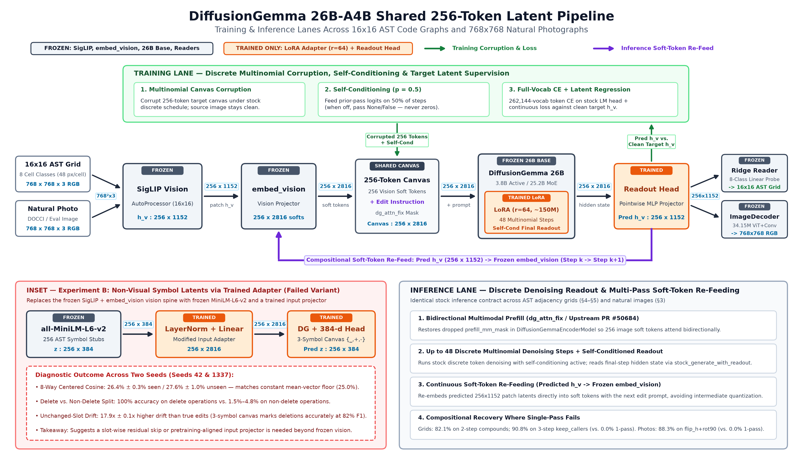

# Title: Latent Roadmaps: DiffusionGemma State Transitions for Code-Graph Refactoring

### Subtitle: We adapt DiffusionGemma's bidirectional canvas to execute multi-step AST code-graph refactoring transitions in latent space.

**Author:** `bumblebeers`

---

## 0. Abstract

Autoregressive coding agents emit tokens left-to-right before downstream call-graph consequences are resolved. Toward structural pre-computation, we study **Latent Roadmaps**: executing caller-specified AST call-graph transitions on DiffusionGemma's (DG 26B-A4B) bidirectional 256-token canvas without syntax emission or autonomous decomposition. Extending a natural-image study (N=300 DOCCI, 91.3% seen / 90.5% unseen 24-way), we test 16-symbol AST call graphs rendered as 16×16 palette grids (768² RGB) and 256-symbol windows embedded via frozen `all-MiniLM-L6-v2`. On held-out `httpx` (N=360, two seeds), LoRA DG reaches **91.9%** 22-way (**62.2%** exact 256-cell grid match) seen, **78.5%** on paraphrases, and **61.4%** on indirect intent—beating ~50M Non-DG transformers (75.7% seen, **7.2%** exact, tied with source copy) and 3-shot **Gemma 4 26B-A4B-it** AR (15.6% seen). Against multimodal **Gemma 4 AR LoRA** (73.9% seen, 70.6% paraphrases, 72.2% indirect intent), DG leads 3.0×–7.5× on exact-grid match (**41.2%–62.2%** vs. **6.4%–14.7%**) and resolves transitive `mark_reachable` (AR LoRA: 0.0%–7.5%), while AR LoRA's LLM priors win 22-way indirect intent (+10.8 pp). Caller-decomposed **re-feeding** reaches **82.1%** on 2-step compounds (vs. 55.0% AR LoRA) and **90.8%** on 3-step `keep_callers`; zero-shot two-seed `click` reaches **90.7%** seen and **83.5%** 2-step re-feed. On ambiguous edits, DG commits deterministically (single-sample **50.4%** unseen vs. Non-DG **15.1%**). Experiment B (two-seed **26.4%** seen) suggests reconstructing 384-d symbol vectors without a residual skip incurs 17.9× drift.

---

## 1. Introduction & Scope

Autoregressive code models emit syntax left-to-right under causal masking, committing to early signatures before downstream callers and transitive dependencies are resolved. Engineers instead reason over dependency graphs—identifying nodes to remove, redirect, or isolate—as a structural specification.

We test whether a discrete diffusion LM executes **structural state transitions** on a 256-token latent canvas: given a source call graph (or symbol window) and an instruction, the model predicts the updated latent state. Scope is explicit: **our system executes caller-specified transitions rather than planning decompositions autonomously, and evaluates latent graph states rather than synthesizing Python code.**

*Figure 1: Shared 256-token SigLIP `h_v` pipeline across natural images and 16×16 AST call graphs, caller-decomposed soft-token re-feeding, and the Exp A vs. B adapter boundary.*

DG 26B-A4B refines all 256 canvas tokens under **bidirectional self-attention** across up to 48 denoising steps, letting adjacency rows and columns constrain each other jointly and supporting multi-step transitions via soft-token re-feeding.

---

## 2. Background & Representation Architecture

### 2.1 DiffusionGemma Stock Contract & Dual Representations
DG 26B-A4B (3.8B active / 25.2B total MoE) denoises a 256-token canvas under multinomial corruption, self-conditioning (`p=0.5`), block-bidirectional multimodal prefill (`dg_attn_fix`), and final self-conditioned step readout (`stock_generate_with_readout`).
- **Experiment A (Visual Adjacency Grids):** 16-symbol Python AST call graphs render as 16×16 8-color grids at 768² RGB (48 px/cell), yielding `h_v` (`256×1152`) via frozen SigLIP and `embed_vision`. Pointwise readouts predict `h_v_hat`, decoded into 8 cell classes (`background`, `edge`, `func`, `method`, `class`, `test`, `selected`, `marked`) by a closed-form Ridge reader fitted on clean `h_v`.
- **Experiment B (Continuous Symbol Latents):** 256-symbol AST stubs embedded via frozen `all-MiniLM-L6-v2` (`d=384`) enter DG through a `LayerNorm(384) + Linear(384, 2816)` projector (**modified model: trained input adapter**, our sole non-stock input interface), paired with a 3-symbol canvas vocabulary (`_` unchanged, `+` edited, `-` deleted) and pointwise 384-d readout.

### 2.2 Anisotropy Alignment
Because raw SigLIP `h_v` and pooled states occupy narrow cones (`cos ≈ 0.30–0.99`, participation ratio `PR ≈ 2.4`), we subtract the training-set mean (`cent_cos`) and Z-standardize channels before candidate lookups.

|Dimension|Natural Images|Exp A: Adjacency Grids|Exp B: Symbol Latents|
|:---|:---|:---|:---|
|Layout|DOCCI 768² (16×16 patches)|16-node AST (16×16 cells)|256-symbol AST window|
|Encoder|Frozen SigLIP|Frozen SigLIP|Frozen `all-MiniLM-L6-v2`|
|Latents|256×1152 (`h_v`) → 2816|256×1152 (`h_v`) → 2816|256×384 (`z`) → 2816|
|Input Path|Frozen `embed_vision`|Frozen `embed_vision`|Trained `LayerNorm+Linear`|
|Evaluation|24-way `h_v` cosine & PSNR|22-way & Exact-grid match|8-way centered cosine|

*Table 1: Cross-domain representation and evaluation summary.*

---

## 3. Empirical Foundation: Natural-Image Patch Transitions

We first benchmarked DG on N=300 held-out DOCCI photographs across a 24-state geometric and photometric pool (`chance = 4.2%`).

### 3.1 Natural-Image Transition Results
Two-seed LoRA DG (`r=64`, ~150M trainable parameters) outperforms 53.6M Non-DG transformers on identity reconstruction (17.28 dB PSNR, 100.0% R@1 vs. Frozen DG 12.41 dB, 7.3%), 6-way geometry (100.0% seen, 89.5% unseen vs. 55.8%), mixed 24-way edits, and held-out `blue_tint` (`fig3_natural_image_contact_sheet.png`):

|Manifest (N=300, K=24)|Dec Ceil|Copy|Frozen DG|Non-DG Frz|Non-DG EncLoRA|**LoRA DG (2-Seed)**|McNemar|
|:---|:---:|:---:|:---:|:---:|:---:|:---:|:---:|
|`seen_bal300`|100.0%|4.7%|12.7%|74.5±1.5%|74.8±0.5%|**91.3±0.0%**|p<1e-11|
|`seen_shuf300` (Shuffled)|100.0%|4.7%|3.0%|2.2±0.5%|1.8±0.2%|**0.0±0.0%**|—|
|`unseen_para_bal300`|100.0%|4.7%|12.3%|32.7±0.3%|61.3±0.3%|**90.5±0.5%**|p<1e-20|
|`heldout_blue_tint_300`|100.0%|0.0%|3.7%|0.0±0.0%|0.0±0.0%|**60.2±5.8%**|p<1e-59|
|`heldout_flip_h_then_rot90`|100.0%|0.0%|2.3%|0.3±0.3%|0.0±0.0%|**0.5±0.2%**|—|
|`refeed_geogeo_bal300` (2-Step)|100.0%|0.0%|3.7%|67.7±1.3%|65.2±0.8%|**88.3±1.7%**|p<1e-17|

*Table 2: Natural-image 24-way nearest-candidate accuracy (N=300 DOCCI).*

### 3.2 Structural Boundaries Motivating Experiment A
1. **Sub-Patch Orientation Invariance:** Intact vs. internally rotated patches (N=250) yield tied cosines (0.3291 vs. 0.3297, p=0.68), showing 16×16 patch routing without sub-patch synthesis and motivating 1-cell-per-patch grids.
2. **Single-Pass Chaining & Opposites:** Unfactored two-step geometric prompts collapse onto the final edit (0.5%), and `brighten`-only training fails on unseen `darken` (8.2%).
3. **Caller-Decomposed Re-Feeding:** Re-feeding step-1 `h_v_hat` through frozen `embed_vision` resolves non-commuting pairs (88.3±1.7% geo×geo; 92.0±0.3% geo×photo).

---

## 4. Methods: Code Graphs, Baselines & Metrics

### 4.1 Pre-Registered Empirical Gates (`PREREG.json`)

|Gate|Domain|Metric|Rule|Outcome|Status|
|:---|:---|:---|:---|:---|:---:|
|**Gate A1 (16²)**|Exp A (16²)|Clean-`h_v` Ridge cell acc|≥0.99 cell, ≥0.95/class|**1.000 all 8 classes**|**PASS**|
|**Gate A1 (32/48²)**|Exp A (32/48²)|Sub-patch packing probe|≥0.99 cell, ≥0.95/class|Cell >0.99, `selected` **0.132**|**FAIL**|
|**Gate A2**|Exp A (Pool)|Max off-target centered cos|Report fraction >0.85|Median 0.8757 (**72.8% >0.85**)|**Measured**|
|**Gate A3**|Exp A (Control)|Non-DG EncLoRA `seen_bal360`|Changed-cell acc >0.0|**90.0% changed** (73.3% 22-way)|**PASS**|
|**Gate B0**|Exp B (Encoder)|`all-MiniLM-L6-v2` isotropy|PR ≥ 20, cos ≤ 0.20|**PR=47.8, cos=-0.0015, Oracle=1.0**|**PASS**|
|**Gate B1**|Exp B (Control)|Non-DG delete slot hit|≥50% (chance 0.39%)|**52.2% (47/90)**|**PASS**|

*Table 3: Pre-registered gate verification prior to DG training.*

Gate A1 confirms 16×16 grids decode losslessly, whereas packing 32² or 48² cells into 256 tokens crushes sparse classes (`selected`: 13.2%). Categorical 8-color separation also bypasses SigLIP LayerNorm luminance loss (brightness conditionals: 48.2% / 23.2%, vs. 83.3±2.7% on palette conditionals, p<1e-12).

### 4.2 Metrics & Baseline Definitions
- **Experiment A Metrics:** On Ridge-decoded 16×16 grids, we report **22-way nearest-candidate accuracy** (strictly smallest Hamming distance among 22 pre-registered states; ties wrong; chance 4.5%), **exact-grid match** (all 256 cells correct), and off-diagonal call **edge F1**.
- **Experiment B Metrics:** Centered cosine nearest-neighbor lookup at edited slots over an 8-candidate AST pool (`chance=12.5%`; `mean-vector floor=25.0%`, since near-zero outputs pick `delete` on delete items).
- **Baselines (`Non-DG` & Matched `Gemma 4 26B-A4B-it` AR):** `NonDGTransformBaseline` is a scratch **4-layer (`d=768`, 12-head) spatial cross-attention transformer (`51.7M` Exp A, `49.9M` Exp B, `53.6M` images)** conditioned on `all-MiniLM-L6-v2` (22.7M) tokens (**Frozen Instr** or `r=16` **Enc LoRA**) with slot residuals (`x ← x+SA+CA+FFN`). As a scale- and family-matched AR baseline sharing the 26B-A4B MoE trunk and frozen 256-token SigLIP stack, we evaluate **`google/gemma-4-26B-A4B-it`** emitting 256 raster digits (`0`–`7`): **Gemma 4 AR Prompted** (768² image + source digit grid + 3 exemplars) and **Gemma 4 AR LoRA** (`r=64`, `74.3M` LM params, 354 steps / 2,832 image+instruction examples).
- **Training & Cutoff:** Standard arms train 4,824 steps (seeds `42`, `1337`) on 1,608 subgraphs across 3 Python repos (`fastapi`, `requests`, `rich`), evaluated zero-shot on `httpx` (N=360) and `click` (N=360). Incomplete runs at cutoff are marked `not run`.

---

## 5. Experimental Results & Analysis

|Model Arm|Natural Images (K=24)|Exp A: Code Graphs (K=22)|Exp B: Symbol Latents (K=8)|Architecture|
|:---|:---:|:---:|:---:|:---|
|**Oracle Ceiling**|100.0% (23.3dB)|100.0% (100% Exact)|100.0% (1.000 Cos)|Ground-truth latent|
|**Chance / Mean Floor**|4.2% chance|4.5% chance|12.5% ch. / 25.0% mean|Analytical floor|
|**Source Copy**|4.7%|7.2% (7.2% Exact)|0.0% hit (0.0 drift)|Unmodified input|
|**Non-DG + Frozen Instr**|74.5% / 32.7%|75.7±4.6% / 39.6±0.4%|46.1±3.9% / 41.7±2.8%|Scratch ~50M + Frz Text|
|**Non-DG + Enc LoRA**|74.8% / 61.3%|73.3±0.0% / 49.2±3.6%|**47.4±1.3%** / **41.3±4.3%**|Scratch ~50M + Enc LoRA|
|**Gemma 4 AR (Prompted)**|not run|15.6% / 13.3%|not run|26B-A4B AR (3-Shot)|
|**Gemma 4 AR (LoRA r=64)**|not run|73.9% / 70.6%|not run|26B-A4B AR + LoRA (354 st.)|
|**Frozen DG + Head**|12.7% / 12.3%|0.3% / 0.0%|not run|Frozen 26B + Readout|
|**LoRA DG**|**91.3%** / **90.5%**|**91.9±1.1%** / **78.5±3.2%**|26.4±0.3% / 27.6±1.0%|26B + LoRA (r=64) + Head|

*Table 4: Seen / unseen paraphrase K-way nearest-candidate accuracy (`httpx` N=360; DOCCI N=300).*

### 5.1 22-Way Selection vs. Exact-Grid Match, Autoregressive Comparison & Cross-Repo Transfer

|Manifest (`httpx`, N=360)|LoRA DG: 22-Way (Exact, F1)|Best Non-DG: 22-Way (Exact)|Gemma 4 AR Prompted: 22-Way (Exact, Parse)|Gemma 4 AR LoRA: 22-Way (Exact, Parse)|Copy Exact|
|:---|:---:|:---:|:---:|:---:|:---:|
|`seen_bal360`|**91.9±1.1%** (**62.2±4.2%**, 94.6%)|75.7±4.6% (**7.2%**)|15.6% (**7.5%**, 99.4% parse)|73.9% (**13.6%**, 89.4% parse)|7.2%|
|`unseen_para_bal360`|**78.5±3.2%** (**47.1±3.7%**, 84.1%)|49.2±3.6% (**3.3%**)|13.3% (**6.4%**, 99.4% parse)|70.6% (**14.7%**, 83.9% parse)|7.2%|
|`unseen_infer_360`|**61.4±2.5%** (**41.2±1.2%**, 79.7%)|23.2±1.2% (**0.0%**)|17.5% (**8.9%**, 99.4% parse)|**72.2%** (13.6%, 85.3% parse)|11.1%|
|`refeed_heldout_comp` (2-Step)|**82.1±1.0%** (**47.8±2.2%**, 98.0%)|34.6±2.4% (**0.0%**)|0.6% (**0.0%**, 99.4% parse)|55.0% (**6.4%**, 86.9% parse)|0.0%|
|3-Step `keep_callers` (n=180)|**90.8±4.2%** (**0.0±0.0%**, 73.1%)|0.0±0.0% (0.0%)|not run|not run|0.0%|

*Table 5: 22-way nearest-candidate accuracy, 256-cell exact-grid match, call-edge F1, and AR exact-256 parse rate on `httpx`.*

- **Headline Gaps & Exact-Grid Fidelity (`fig1_code_graph_contact_sheet.png`):** On **exact 256-cell match**, LoRA DG leads every baseline by **3.0×–7.5×**: **62.2±4.2%** vs. 13.6% seen, **47.1±3.7%** vs. 14.7% paraphrases, **41.2±1.2%** vs. 13.6% indirect intent, and **47.8±2.2%** vs. 6.4% 2-step re-feed (Non-DG seen exact: **7.2%**, equal to copy; **0.0% exact on non-identity ops**). On **22-way**, DG leads the strongest baseline by **+16.2 pp** seen (vs. 75.7% Non-DG; +18.0 pp vs. 73.9% AR LoRA, p<1e-8), **+7.9 pp** on paraphrases (vs. **70.6%** AR LoRA; +29.3 pp vs. 49.2% Non-DG, p<1e-15), and **+27.1 pp** on 2-step re-feed (vs. **55.0%** AR LoRA), whereas on indirect intent `Gemma 4 AR LoRA` leads 22-way (**72.2% vs. 61.4%**, **-10.8 pp**; DG vs. Non-DG: +38.2 pp, p<1e-31).
- **Matched-Scale Gemma 4 AR Comparison:** 3-shot `Gemma 4 AR Prompted` (**99.4%** parse) scores **15.6% seen, 13.3% unseen, 17.5% indirect intent, and 0.6% 2-step** (7.5%, 6.4%, 8.9%, 0.0% exact), understanding lexical intent (`delete_tests`: 55.0%) while collapsing on 2D permutations (`reverse_order`: 0.0%, `reverse_edges`: 0.0%–3.8%). `Gemma 4 AR LoRA` (`r=64`) reaches **73.9%, 70.6%, 72.2%, and 55.0%** (**89.4%, 83.9%, 85.3%, 86.9% parse**; 81.3%, 75.6%, 79.0%, 78.7% F1), beating DG on 22-way indirect intent via pretrained category priors (`delete_tests`: **95.0%**, `delete_classes`: **77.5%** vs. DG 2.5%–15.0%), yet causal raster decoding fails on multi-hop transitive closure (**`mark_reachable`: 0.0%–7.5%**; 2-step `+*mark_reachable`: **1.4%**) and `reverse_edges+reverse_order` (**15.4% / 11.5%**) at ~23× higher latency (~640s vs. ~28s/split).
- **Shuffled Control:** On `seen_shuf360` (mismatched pairs), LoRA DG scores **0.6±0.3%** (below 4.5% chance) by faithfully applying the shuffled edit.
- **Bimodal Indirect Intent:** On `unseen_infer_360`, `reverse_order`, `delete_selected`, `keep_callees`, and `selected_first` hit **100.0% (40/40)** on both seeds (`reverse_edges`: 45.0%/100.0%; `mark_reachable`: 67.5%/65.0%), while `identity` (**0/40**), `delete_tests` (**1/40–2/40**), and `delete_classes` (**2/40–6/40**) fail without verb overlap.
- **Zero-Shot `click` Transfer (N=360, Two Seeds):** LoRA DG reaches **90.7±2.4% / 61.7±0.3% exact** seen (94.7% F1), **77.1±4.6% / 46.9±8.3% exact** paraphrases (84.0% F1), **62.8±3.9% / 38.3±0.0% exact** indirect intent (80.0% F1), and **83.5±1.8% / 47.2±6.4% exact** 2-step re-feed (98.4% F1) vs. best Non-DG `72.1%`, `46.1%`, `24.4%`, `41.0%` (`7.4%`, `3.8%`, `0.0%`, `0.0%` exact).

### 5.2 Held-Out Node Categories & Commuting Compounds
Zero-shot node-category transfer **fails**: held-out `delete_methods` scores 13.2±2.9% 22-way (**0.0% exact**) on LoRA DG (Non-DG: 6.9±2.8%), and 1-pass `keep_callers` / `mark_ancestors` score 0.0%. On **commuting** compounds, 1-pass LoRA DG reaches **99.3±0.7%** on `reverse_order + delete_selected` (p<1e-89) and **98.6±1.4%** on `reverse_order + delete_tests` vs. Non-DG 8.1% and 6.5%.

### 5.3 Caller-Decomposed Re-Feeding & 3-Step Mirror Chains
Caller-decomposed re-feeding through `embed_vision` lifts 5-compound accuracy from 48.0±1.7% (1-pass) to **82.1±1.0% 22-way** and **47.8±2.2% exact** (98.0% F1; AR LoRA: 55.0% / **6.4% exact**; Non-DG: 34.6% / **0.0% exact**, p<1e-41), raising `reverse_edges + keep_callees` from 0.3% to **100.0±0.0%** (AR LoRA: 80.6%), `delete_tests + mark_reachable` to **70.1±2.1%** (AR LoRA: **1.4%**), and `reverse_edges + mark_reachable` to **40.3±2.8%** (AR LoRA: **1.4%**). A **3-step mirror chain** (`reverse_edges → keep_callees → reverse_edges`; `fig2_refeed_strip_keep_callers.png`) reaches **90.8±4.2% 22-way** on unseen `keep_callers` (45.4±2.1% chain-wide; `mark_ancestors`: 0.0%; Non-DG/Frozen DG: 0.0%, p<1e-51), though **exact match is 0.0% on both seeds** (97.2% cell acc, 73.1% `keep_callers` F1, 84.5% chain F1) from single-cell drift.

### 5.4 Open-Ended Edits: Branch Commitment, Not Diversity
On ambiguous edits with 2–3 valid targets (`cut_one_call`, `delete_one_callee`, `delete_one_test`), continuous MSE averages branches (strongest Non-DG: **26.0%** seen Enc LoRA, **15.1%** unseen Frozen Instr; Enc LoRA unseen: 11.4%). Single-sample LoRA DG hits a valid branch on **49.5±7.0%** seen and **50.4±5.2%** unseen (**55.0±5.8%** seen and **56.1±5.3%** unseen valid in any of 4 samples; first-valid 39.8% vs. 42.5% uniform), yet **all 4 sampler seeds return nearly identical grids (`1.005–1.035` distinct valid answers/item)**—deterministic commitment rather than diverse sampling.

### 5.5 Experiment B: Cold-Start Continuous Symbol Injection Boundary
Scratch `NonDGTransformBaseline` (49.9M) reaches 47.4±1.3% seen and 41.3±4.3% unseen (`click`: 39.2% / 32.8%), with re-feeding lifting k=2 all-sites accuracy from 5.6% to 40.9% (k=4: 1.3% → 34.2%). Across two seeds (`42`, `1337`), LoRA DG reaches **98.5±0.3%** 3-class (`_`/`+`/`-`) canvas accuracy yet scores **26.4±0.3% seen, 27.6±1.0% unseen, 25.0±0.3% shuffled, 25.7±0.1% unseen-arg, and 50.0±0.0% `renameclass`** (**100.0±0.0% `delete` recall** vs. **1.5–4.8% non-delete**; **17.9±0.1× drift**; s42 k=2: 5.3% 1-pass / 5.3% re-feed; k=4: 0.6% / 0.6%, `19.3×` drift; s1337 k=2,4 and Frozen DG `not run`), matching the 25.0% / 50.0% mean-vector floor. Subject to unmatched baseline scale, this two-seed contrast **suggests** reconstructing all 256×384 vectors across a 3-symbol canvas vocabulary without a slot-wise residual skip lets unchanged-slot drift swamp single-symbol edits—an untested gated-residual hypothesis.

---

## 6. Related Works

1. **Latent World Models & Continuous Reasoning:** LPN [10] searches continuous program latents; Tycho [16] and DreamTeam [21] maintain structured agent states. Coconut [13] passes continuous *text-latent* states across steps, COVT [20] and Latent Sketchpad [24] use visual-latent tokens, and DINO-WM [25], LeWorldModel [18], and V-JEPA 2 [3] model dynamics in frozen visual features.
2. **Code Graphs & Code LLMs:** Code Property Graphs [23], Allamanis et al. [1], GraphCodeBERT [11], and ProGraML [6] represent AST, data-flow, and call graphs for GNNs, whereas StarCoder [26] and DeepSeek-Coder [12] linearize files left-to-right.
3. **Diffusion Language Models:** LLaDA [19] and Scaling-DLM [9] train masked diffusion LMs; DiffusionGemma [7] denoises a 256-token Gemma-4 canvas analyzed by Asaria et al. [2] and Engels et al. [8], alongside Transfusion [27].
4. **Perceptual Grounding:** PaLM-E [28], RT-2 [5], and GILL [14] project frozen visual latents into LM trunks; we adapt frozen `SigLIP + embed_vision` to discrete AST grids.
5. **Anisotropy & Alignment:** Gao et al. [29] and Ethayarajh [30] document narrow-cone degeneration; REPA [22], GAP [17], LatentLens [15], and LeJEPA [4] regularize latent geometry.

---

## 7. Reusable Resources & Verifiable Artifacts

- **Standalone Python Libraries (`v0.1.0`):** [`dgg-latent`](https://github.com/bumblebeers/dgg-latent) (continuous latent diffusion losses, readout heads, and `stock_generate_with_readout`), [`dgg-codebook`](https://github.com/bumblebeers/dgg-codebook) (continuous vocabulary chords, de-biasing, and spatial teachers), and [`dgg-vit-decoder`](https://github.com/bumblebeers/dgg-vit-decoder) (loader for the 572.8M SigLIP vision stack and 34.15M ViT+Conv `h_v → 768²` decoder).
- **Upstream `transformers` Bugfix ([`huggingface/transformers#50684`](https://github.com/huggingface/transformers/pull/50684), `dg_attn_fix`):** Fixes the dropped `create_masks_for_generate(...)` assignment in `DiffusionGemmaEncoderModel.forward` under 2D `attention_mask`, a bug that persists through `transformers` 5.22.2 (fork branch [`bumblebeers/transformers:fix/diffusion-gemma-prefill-multimodal-masks`](https://github.com/bumblebeers/transformers/tree/fix/diffusion-gemma-prefill-multimodal-masks)).
- **Open Benchmark Bundle, Adapters & Raw Predictions:** SHA-256 cataloged across [`bumblebeers/dgg2-latent-code-graphs`](https://github.com/bumblebeers/dgg2-latent-code-graphs) (`PREREG.json`, scorers `cg/cg_score_preds.py` & `cg/cg_node_metrics.py`), [`bumblebeer/dgg2-code-graph-benchmarks`](https://huggingface.co/datasets/bumblebeer/dgg2-code-graph-benchmarks) and [`unclebumblebeer/dgg2-code-graph-benchmarks`](https://www.kaggle.com/datasets/unclebumblebeer/dgg2-code-graph-benchmarks) (`.npz` packs plus raw predictions: `uint8` `(360, 16, 16)` Exp A grid `.npy` files in `predictions/expA_grids/` and `outputs/m2/decoded_grids_all_arms.npz`, `(360, 256, 1152)` `h_v` `.npy` arrays in `predictions/expA_hv/`, and `(N, 256, 384)` Exp B `.npy` arrays in `predictions/expB_vec/`), and [`bumblebeer/dgg2-latent-code-graphs-adapters`](https://huggingface.co/bumblebeer/dgg2-latent-code-graphs-adapters) (two-seed LoRA adapters, readout heads, and `ImageDecoder` weights).

---

## 8. Limitations & Future Work

1. **Control Parity & Raw-Source Baselines:** Scratch ~50M `NonDGTransformBaseline` is not parameter-matched to 26B DG, `Gemma 4 AR LoRA` runs a wall-clock-bounded 354-step single-seed schedule on rasterized grids, and we evaluate 16×16 graph transitions rather than AR agents editing raw Python source files directly.
2. **Caller Decomposition & No Code Synthesis:** Multi-step re-feeding uses caller-supplied step prompts, and predicted 16×16 graphs are not yet compiled into source diffs.
3. **Resolution, 3-Step Drift & Cold-Start Adapters:** Sub-patch packing (32²/48²) crushes sparse classes (`selected`: 13.2%), 3-step chains hit 0.0% exact match (`mark_ancestors`: 0.0%), and Exp B incurs 17.9× drift without a tested gated residual skip (`z_hat = g * z_dec + (1 - g) * z_src`).

*The natural-image study (§3) was human-designed and human-led with LLM coding assistance. The code-graph experiments (§4–§5) were run in the final 48 hours by an LLM agent under the author's direction, with two seeds; all predictions are released for independent rescoring.*

---

## References

[1] M. Allamanis et al., "Learning to Represent Programs with Graphs," ICLR, 2018.  
[2] C. Asaria et al., "Neither Parallel Nor Sequential: How DiffusionGemma Actually Commits Tokens," arXiv:2606.14620, 2026.  
[3] M. Assran et al., "V-JEPA 2: Self-Supervised Video Models," arXiv:2506.09985, 2025.  
[4] R. Balestriero & Y. LeCun, "LeJEPA: Self-Supervised Learning Without Heuristics," arXiv:2511.08544, 2025.  
[5] A. Brohan et al., "RT-2: Vision-Language-Action Models," arXiv:2307.15818, 2023.  
[6] C. Cummins et al., "ProGraML: Graph-based Program Representation," ICML, 2021.  
[7] DiffusionGemma Team, "DiffusionGemma Technical Report," arXiv:2608.00146, 2026.  
[8] J. Engels et al., "How Transparent is DiffusionGemma?," arXiv:2606.20560, 2026.  
[9] S. Gong et al., "Scaling Diffusion LMs via Adaptation from AR Models," ICLR, 2025.  
[10] M. V. Macfarlane & C. Bonnet, "Searching Latent Program Spaces," NeurIPS, 2025.  
[11] D. Guo et al., "GraphCodeBERT: Pre-training Code Representations with Data Flow," ICLR, 2021.  
[12] D. Guo et al., "DeepSeek-Coder," arXiv:2401.14196, 2024.  
[13] S. Hao et al., "Training LLMs to Reason in a Continuous Latent Space," arXiv:2412.06769, 2024.  
[14] J. Y. Koh et al., "Generating Images with Multimodal LMs," arXiv:2305.17216, 2023.  
[15] B. Krojer et al., "Revealing Highly Interpretable Visual Tokens in LLMs," arXiv:2602.00462, 2026.  
[16] J. Lehmann et al., "Tycho: Programmatic World Models for ARC-AGI-3," arXiv:2607.28287, 2026.  
[17] Y. Miao et al., "Fill the GAP: Granular Alignment for Visual Reasoning," arXiv:2605.12374, 2026.  
[18] Q. Maes et al., "LeWorldModel: End-to-End JEPA," arXiv:2603.19312, 2026.  
[19] S. Nie et al., "Large Language Diffusion Models," ICML, 2025.  
[20] Y. Qin et al., "Chain-of-Visual-Thought: Continuous Visual Tokens," arXiv:2511.19418, 2025.  
[21] E. Sarafian et al., "Workspace Optimization: How to Train Your Agent," arXiv:2605.09650, 2026.  
[22] S. Yu et al., "Representation Alignment for Generation," ICLR, 2025.  
[23] F. Yamaguchi et al., "Vulnerability Discovery with Code Property Graphs," IEEE S&P, 2014.  
[24] H. Zhang et al., "Latent Sketchpad: Sketching Visual Thoughts in MLLMs," arXiv:2510.24514, 2025.  
[25] G. Zhou et al., "DINO-WM: World Models on Pre-trained Visual Features," arXiv:2411.04983, 2024.  
[26] R. Li et al., "StarCoder: may the source be with you!," TMLR, 2023.  
[27] C. Zhou et al., "Transfusion: Next Token and Diffuse Images in One Model," arXiv:2408.11039, 2024.  
[28] D. Driess et al., "PaLM-E: An Embodied Multimodal LM," ICML, 2023.  
[29] J. Gao et al., "Representation Degeneration in Language Modeling," ICLR, 2019.  
[30] K. Ethayarajh, "How Contextual are Contextualized Word Representations?," EMNLP, 2019.  
